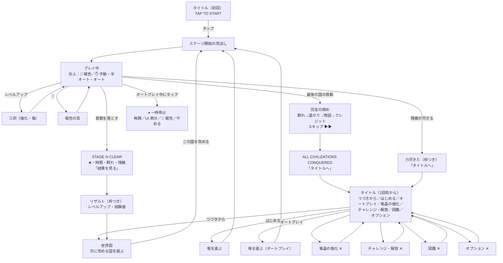

# Dragon Tide 画面の流れ（案帳 DT-640）

製品化に向けて、画面の流れと見た目をそろえるための下調べ。v3.221.0 の時点の画面を全部開いて調べた（2026-11-26）。
そろえる所は Shooter に選んでもらってから直す（このファイルは「いま」と「直す候補」の一覧）。

## 1. 流れ図（いま）

## 2. 画面ごとの今の作り

| 画面 | 入れ物 | 見出し | 閉じる・戻る | 主なボタン |
|---|---|---|---|---|
| タイトル | `#title-overlay` | 竜潮 / DRAGON TIDE | — | 枠線のボタンを縦に並べる（幅は文字の長さで変わる） |
| 竜を選ぶ | `#levelup-overlay`（三択と同じ入れ物） | 「竜を選ぶ」水色 | 「もどる」は一覧のいちばん下（画面の外）→ v3.222.0 で右上に ✕ も | 2列のカード |
| 竜晶の強化 | `#tree-overlay` | 金色・左 | ✕ 右上 | ノードの木 |
| チャレンジ・解放 | `#challenge-overlay` | 金色・左 | ✕ 右上（達成数の右） | 一覧 |
| 図鑑 | `#codex-overlay` | 金色・左 | **✕ 見出しのすぐ右** | タブ |
| オプション | `#options-overlay` | 金色・左 | **✕ 見出しのすぐ右** | 行ごとにたたく |
| ステージ開始 | `#stage-overlay` | STAGE N / 時代 | 触ると下がる | — |
| ステージクリア | `#overlay`（文字だけ） | STAGE N CLEAR（灰色の大きな字） | — | 赤い丸ボタン「結果を見る」 |
| リザルト | 枠つきのカード | ── リザルト ── | — | （数え上げのあと世界図へ） |
| 世界図 | `#world-map-overlay`（古地図） | 世界図 | — | 「この国を攻める」 |
| 力尽きた | 枠つきのカード | ── 力尽きた ── | — | 赤い丸ボタン「タイトルへ」 |
| 完走 | `#overlay`（文字だけ） | ALL CIVILIZATIONS CONQUERED | — | 「タイトルへ」 |
| 一時停止 | `#autoplay-pause` | ⏸ 一時停止 | 再開 | **オートプレイのときだけ**。手でのプレイには一時停止が無い |

## 3. そろっていない所・足りない画面（直す候補）

1. **閉じる ✕ の位置がばらばら**：竜晶の強化・チャレンジは右上、図鑑・オプションは見出しのすぐ右。→ 全部右上の同じ位置・同じ大きさに。**（v3.222.0 で直した）**
2. **竜を選ぶ画面の「もどる」が見えない**：「もどる」は一覧のいちばん下にあり、竜が増えて画面の外になっている。→ 右上に ✕（タイトルへ）。**（v3.222.0 で直した）**
3. **見出しの書体と色**：竜を選ぶは水色・ほかは金色、ステージクリアは灰色の大きな英字、リザルト・力尽きたは枠つきの明朝。→ 「メニュー系（金色・左上）」と「結果系（枠つきのカード）」の2種類に寄せる。
4. **結果の画面が3種類の作り**：ステージクリア（文字だけ）→ リザルト（枠つき）の2段、力尽きた（枠つき1枚）、完走（文字だけ）。→ 3つとも枠つきのカード1枚の形にそろえ、ステージクリアの2段を1枚にまとめる。
5. **英語と日本語が混ざる**：STAGE 1 CLEAR・ALL CIVILIZATIONS CONQUERED・TAP TO START・STONE AGE（HUD）と、日本語の見出し（リザルト・力尽きた）。→ どちらかに寄せる（多言語化のとき切り替える前提で、日本語版は日本語に）。
6. **手でのプレイに一時停止が無い**：オートプレイだけタップで一時停止の窓が出る。→ 手でのプレイにも ⏸（再開・オプション・タイトルへ戻る＝ランをあきらめる）を置く。
7. **タイトルのボタンの幅**：文字の長さで幅が変わる。→ 同じ幅にそろえる。**（v3.222.0 で直した）**
8. **オプションの「BGM の曲」**：音を読み終える前は曲の名前でなく `standard` と出る。→ 読み込む前も名前を出す。**（v3.222.0 で直した）**
9. **権利表記**：クレジットは完走の締めのあとにだけ出る（DT-642・Shooter の決定）。使っている書体などの権利表記を出す所は無い。→ 製品版で要るなら、オプションの一番下に「権利表記」を足す。

## 4. 進め方の案

- 1回目（v3.222.0）：この一覧と、1・2・7・8（閉じる位置・戻る・ボタンの幅・曲の名前）＝小さく、遊びに触らない所。
- 2回目：3・4（見出しと結果の画面のカードをそろえる）。
- 3回目：6（手でのプレイの一時停止）。
- 5（言葉）と 9（権利表記）は Shooter の判断待ち。
